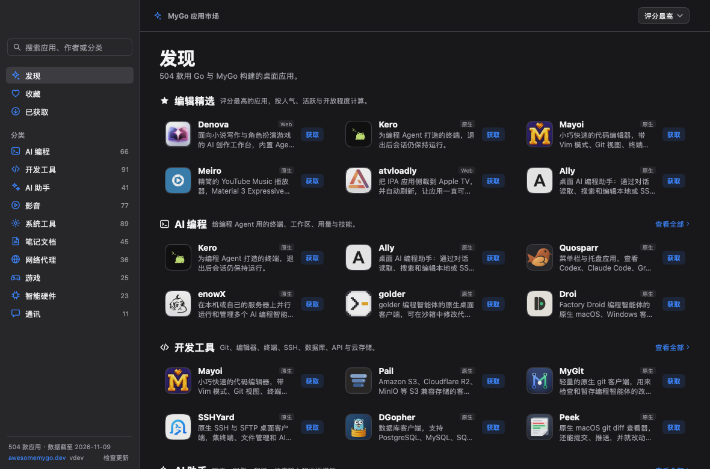
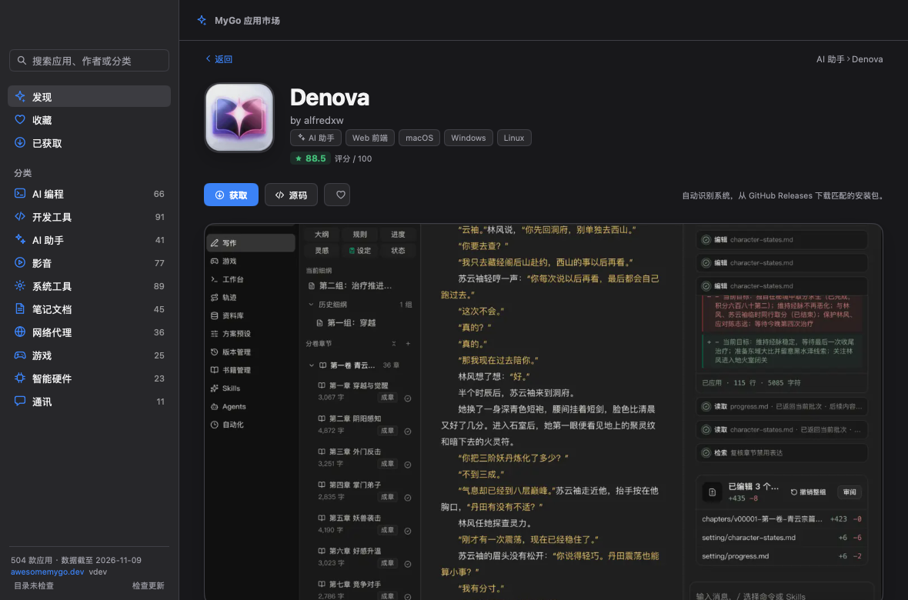

# MyGo Store

A native macOS app marketplace for projects built with [MyGo](https://github.com/egoist/mygo), inspired by [Applite](https://github.com/milanvarady/Applite). It browses the [Awesome MyGo showcase](https://awesomemygo.dev/showcase): 504 apps, grouped by category, with scores, screenshots and links to each project.





## Why it is a snapshot

The showcase data and images are bundled with the app, so it opens instantly and works offline. `scripts/sync.py` refreshes them from the upstream catalog.

## Run

Requires Go 1.27 or later. Everything else, including the UI toolkit, is a Go dependency.

```sh
go tool mygo dev     # development app, rebuilds on change
go run .             # a quick run without the app bundle
```

## Build

```sh
go tool mygo build   # packaged apps in build/
```

The app's name, identifier, version and icon are in `mygo.json` and `resources/icon.png`.

## Release

Push a `v*` tag and GitHub Actions does the rest:

```sh
git tag v0.2.0
git push origin v0.2.0
```

The workflow in `.github/workflows/release.yml` runs the tests, takes the version from the tag, builds a universal macOS app for Apple silicon and Intel, writes `SHA256SUMS`, and creates the GitHub Release. Tags with a suffix such as `v0.2.0-beta.1` become prereleases. You can also run it from the Actions page with an existing tag.

- The version is written into `mygo.json` only for that build; nothing is committed back.
- The release contains `mygo-store-<version>.dmg` and `SHA256SUMS`.
- Builds use MyGo's default ad-hoc signature. To distribute without Gatekeeper warnings, configure `macos.signingIdentity` and `macos.notarize` in `mygo.json`, add the Developer ID certificate and notary credentials as Actions secrets, and import them in the workflow.

## Data

`data/apps.json` is generated from [`yldm-tech/awesome-mygo`](https://github.com/yldm-tech/awesome-mygo), which also builds the showcase site. The score is a port of the site's `packages/catalog/src/score.ts`, so the numbers match awesomemygo.dev.

```sh
python3 scripts/sync.py                  # refresh catalog, icons and screenshots
python3 scripts/sync.py --no-assets      # data only, keep existing images
python3 scripts/sync.py --force-assets   # download images again
python3 scripts/sync.py --catalog DIR    # use an unpacked catalog/data directory
```

Only Python 3.11's standard library is needed. Icons and screenshots go to `assets/icons` and `assets/shots` and are embedded with `go:embed`. Apps whose images are missing fall back to a generated letter tile and a gradient placeholder.

## How it works

- **Discover** — top-scored apps and a shelf per category.
- **Browse** — a virtualized grid per category, the favorites, the acquired apps, or a search. Filter by native/web and platform, and sort by score, date or likes.
- **Detail** — icon, tags, score, screenshot, description, facts, source link and the author's other apps.
- **获取** — detects the current OS and architecture, queries the app's GitHub Releases, and downloads the best matching installer (`.dmg`/`.pkg` on macOS, `.exe`/`.msi` on Windows, `.AppImage`/`.deb`/`.rpm` on Linux). The file is saved to `~/Downloads/MyGo Store`, then revealed in Finder; the button becomes **打开安装包**. If a release has no matching asset, or the project has no repository, the official page opens instead. Installers are never run automatically.

Favorites, acquired apps and downloaded installer paths are saved to `state.json` under the user's config directory (`~/Library/Application Support/MyGo Store` on macOS). Set `MYGO_STORE_CONFIG` to use another directory, and `MYGO_STORE_DOWNLOADS` to change the download folder.

GitHub's unauthenticated API allows 60 requests an hour. A request is made only when you press 获取, and the app keeps the downloaded file so later presses open it directly.

| Shortcut | Action |
|---|---|
| `⌘F` | Focus the search field |
| `⌘1` / `⌘2` / `⌘3` | Discover / Favorites / Acquired |
| `⌘[` or `Esc` | Back from a detail page |

## Layout

| File | |
|---|---|
| `main.go` | App state, window, sidebar and title bar |
| `catalog.go` | Embedded catalog, groups, filtering and sorting |
| `discover.go` | Discover page and app rows |
| `browse.go` | Category, search, favorites and acquired grids |
| `detail.go` | App detail page and installer actions |
| `acquire.go` | 获取 flow, download seeding and fallback |
| `release.go` | GitHub Releases client, asset matching and downloads |
| `assets.go` | Embedded images, bitmap cache and fallbacks |
| `prefs.go` | Favorites, acquired apps and installer paths |
| `icons.go` | Inline SVG icons |
| `scripts/sync.py` | Catalog and image sync |
| `*_test.go` | Headless interaction tests and snapshots |

## Snapshots

The views render without a window, which makes them easy to inspect in CI:

```sh
SNAP_DIR=/tmp/mygo-shots go test -run TestSnapshots .
```

## License

The app's own code is MIT. App icons, screenshots, names and descriptions belong to their authors.
