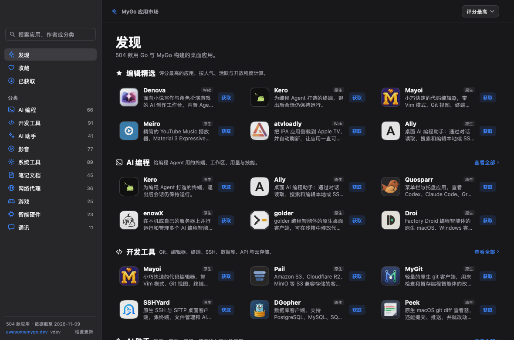
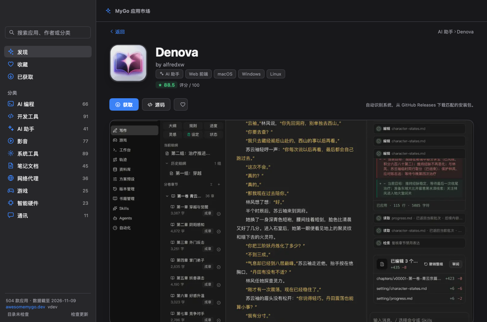

# MyGo Store

[English](README.md) · 中文

一个用 [MyGo](https://github.com/egoist/mygo) 原生 UI 构建的跨平台应用市场，界面灵感来自 [Applite](https://github.com/milanvarady/Applite)。它浏览 [Awesome MyGo showcase](https://awesomemygo.dev/showcase) 中的数百款应用，按分类展示评分、截图和项目链接，支持 macOS、Windows 和 Linux。





## 功能

- **发现**：按评分推荐应用，每个分类一个横向列表。
- **浏览**：分类、收藏、已获取和搜索结果使用虚拟化网格；可以按原生/Web、平台筛选，并按评分、日期或点赞排序。
- **详情**：图标、标签、评分、截图、介绍、项目信息、源码链接和同作者的其他应用。
- **获取**：自动识别当前系统和架构，从应用自己的 GitHub Releases 中挑选匹配的安装包并下载（macOS 的 `.dmg`/`.pkg`，Windows 的 `.exe`/`.msi`，Linux 的 `.AppImage`/`.deb`/`.rpm`）。安装包保存在 `~/Downloads/MyGo Store`，下载完成后可在 Finder 中显示；再次点击会直接打开已下载的安装包。没有匹配资源时打开应用官网。应用不会自动运行安装包。
- **收藏与记录**：收藏、已获取应用和安装包路径保存在用户配置目录的 `state.json` 中。
- **自动更新**：启动约 10 秒后检查新版本，之后每天检查一次；有新版时显示更新说明，可以下载、安装并重启。也可以从菜单「检查更新…」或侧边栏底部「检查更新」手动检查。
- **目录同步**：内置目录快照，启动后自动从 `catalog-latest` Release 获取最新应用列表，并缓存到本地。

## 系统要求

| 系统 | 支持情况 |
|---|---|
| macOS 12 及以上 | Apple 芯片与 Intel，通用安装包 |
| Windows 10/11 | x64 与 ARM64 安装包 |
| Linux | x64 与 ARM64；需要 GTK 3，原生 UI 不需要 WebKitGTK |

## 下载

从 [Releases](https://github.com/tk103331/mygo-store/releases/latest) 下载：

- **macOS**：`mygo-store-<version>.dmg`，打开后把 MyGo Store 拖入「应用程序」。
- **Windows**：`mygo-store-setup-<version>-amd64.exe` 或 `mygo-store-setup-<version>-arm64.exe`。
- **Linux**：`.deb`、`.tar.gz`，或使用安装脚本：

```sh
curl -fsSL https://github.com/tk103331/mygo-store/releases/latest/download/install.sh | sh
```

macOS 构建使用 ad-hoc 签名。如果首次打开被 Gatekeeper 拦截，请在「系统设置 → 隐私与安全性」中允许。Windows 安装包未做代码签名，SmartScreen 可能提示，选择「更多信息 → 仍要运行」即可。

## 自动更新

从 0.2.0 开始，应用使用 MyGo 的签名更新机制：

- 启动后自动检查，之后每天检查一次。
- 也可以从菜单栏「MyGo Store → 检查更新…」或侧边栏底部的「检查更新」手动触发。
- 更新包使用 Ed25519 签名，应用只接受与内置公钥匹配的更新。
- 下载完成后可以立即重启进入新版本，也可以在下次启动时生效。
- 开发构建（`go run .`、`mygo dev`）以及由系统包管理器安装的版本不会自动更新。

发布更新需要仓库 Secret `MYGO_UPDATER_PRIVATE_KEY`。本地私钥默认位于 `~/Library/Application Support/mygo/update-keys/mygo-update.key`，请务必备份；丢失后将无法向已安装用户推送更新。

## 应用目录同步

`data/apps.json` 会打包进应用，作为启动时的离线快照，所以应用可以立即打开并离线使用。运行期间，应用也会自动保持目录最新：

- 启动约 10 秒后检查一次，之后每 6 小时检查一次。
- 从固定标签的 [`catalog-latest`](https://github.com/tk103331/mygo-store/releases/tag/catalog-latest) Release 下载 `apps.json`。
- 使用 ETag 条件请求；内容没有变化时不会重复下载。
- 只有比当前目录更新的文件才会被采用，格式无效或更旧的目录会被忽略。
- 检查成功后缓存为配置目录中的 `catalog.json`，下次启动优先使用较新的缓存。
- 侧边栏底部显示目录状态，点击可以立即检查。

`.github/workflows/catalog.yml` 每天 03:17 UTC 自动运行，也可以在 Actions 页手动触发：

1. 运行 `scripts/sync.py` 刷新目录、图标和截图。
2. 仅当 `data/` 或 `assets/` 有变化时提交，上游没有变化时不会产生每日提交。
3. 确保 `catalog-latest` Release 存在；当 `apps.json` 变化或缺失时上传。该标签不会成为 latest，`releases/latest` 始终指向应用版本，因此不会影响自动更新。

`scripts/sync.py` 在来源、日期和应用列表都没有变化时保留原有的 `syncedAt`，所以空闲的一天不会提交，也不会重新发布目录。

## 开发

需要 Go 1.27 或更高版本。UI、网络和打包工具都是 Go 依赖。

```sh
go tool mygo dev     # 开发应用，改动后自动重建
go run .             # 不打包，直接运行
```

## 构建

```sh
go tool mygo build                                  # 当前平台
go tool mygo build -platform darwin/universal       # macOS 通用包
go tool mygo build -platform windows/amd64,windows/arm64
go tool mygo build -platform linux/amd64,linux/arm64
```

构建产物位于 `build/<os>-<arch>/`。应用名称、标识、版本、图标和更新配置位于 `mygo.json` 与 `resources/icon.png`。

带更新文件的构建需要私钥：

```sh
MYGO_UPDATER_PRIVATE_KEY="$(cat "$HOME/Library/Application Support/mygo/update-keys/mygo-update.key")" \
  go tool mygo build -platform darwin/universal
```

## 发布

推送 `v*` 标签后，GitHub Actions 会构建全部平台并创建 Release：

```sh
git tag v0.2.0
git push origin v0.2.0
```

`.github/workflows/release.yml` 的流程：

1. 校验标签、运行测试，并创建草稿 Release。
2. 三个平台并行构建：
   - macOS：`darwin/universal`，生成 `.dmg`。
   - Windows：`windows/amd64,windows/arm64`，生成安装程序。
   - Linux：`linux/amd64,linux/arm64`，生成 `.deb`、`.tar.gz`、`install.sh`。
3. 每个平台同时上传安装包、更新归档、增量更新和 `update-<platform>.json`。
4. 全部完成后自动发布 Release，并合并 `SHA256SUMS`。

版本号由标签决定，只会写入该次构建，不会回写仓库。带后缀的标签（例如 `v0.2.0-beta.1`）会发布为预发布版本。

首次发布前，需要把更新私钥写入仓库 Secret：

```sh
gh secret set MYGO_UPDATER_PRIVATE_KEY < "$HOME/Library/Application Support/mygo/update-keys/mygo-update.key"
```

也可以在 Actions 页手动运行工作流并填入已有的标签。

## 数据

`data/apps.json` 由 [`yldm-tech/awesome-mygo`](https://github.com/yldm-tech/awesome-mygo) 生成，该仓库同时构建 showcase 站点。评分逻辑移植自站点的 `packages/catalog/src/score.ts`，因此数字与 awesomemygo.dev 一致。

```sh
python3 scripts/sync.py                  # 刷新目录、图标和截图
python3 scripts/sync.py --no-assets      # 只更新数据，保留已有图片
python3 scripts/sync.py --force-assets   # 重新下载图片
python3 scripts/sync.py --catalog DIR    # 使用已解压的 catalog/data 目录
```

只需要 Python 3.11 标准库。图标和截图位于 `assets/icons`、`assets/shots`，通过 `go:embed` 打包进应用。缺少图片的应用会使用字母占位图和渐变占位图。

## 环境变量

| 变量 | 作用 |
|---|---|
| `MYGO_STORE_CONFIG` | 覆盖配置目录（默认 `~/Library/Application Support/MyGo Store`） |
| `MYGO_STORE_DOWNLOADS` | 覆盖安装包下载目录 |
| `MYGO_STORE_CATALOG_URL` | 覆盖目录下载地址 |
| `MYGO_STORE_CATALOG_INTERVAL` | 目录检查间隔，例如 `6h`；设为 `0` 关闭 |
| `MYGO_STORE_CATALOG_DISABLE` | 设为 `1` 关闭运行时目录同步 |
| `MYGO_UPDATER_PRIVATE_KEY` | 构建签名更新时使用的私钥内容 |
| `GH_TOKEN` / `GITHUB_TOKEN` | 上传 Release 时使用 |

GitHub 未认证 API 每小时允许 60 次请求。应用只在你点击「获取」时查询 GitHub Releases，并会保留已下载的安装包。

## 快捷键

| 快捷键 | 操作 |
|---|---|
| `⌘F` | 聚焦搜索框 |
| `⌘1` / `⌘2` / `⌘3` | 发现 / 收藏 / 已获取 |
| `⌘[` 或 `Esc` | 从详情页返回 |

## 目录结构

| 文件 | 作用 |
|---|---|
| `main.go` | 应用状态、窗口、侧边栏和标题栏 |
| `update.go` | 自动更新插件和「检查更新…」菜单 |
| `catalog.go` | 内置目录、分类、筛选和排序 |
| `catalog_sync.go` | 运行时目录刷新、缓存和状态 |
| `discover.go` | 发现页和应用列表 |
| `browse.go` | 分类、搜索、收藏和已获取网格 |
| `detail.go` | 应用详情页和安装包操作 |
| `acquire.go` | 「获取」流程、下载恢复和回退 |
| `release.go` | GitHub Releases 客户端、资源匹配和下载 |
| `assets.go` | 内置图片、位图缓存和占位图 |
| `prefs.go` | 收藏、已获取应用和安装包路径 |
| `icons.go` | 内联 SVG 图标 |
| `scripts/sync.py` | 目录和图片同步 |
| `*_test.go` | 无窗口交互测试和快照 |

## 快照

视图可以在没有窗口的情况下离屏渲染，方便检查界面：

```sh
SNAP_DIR=/tmp/mygo-shots go test -run TestSnapshots .
```

## 许可证

应用自身代码使用 MIT 许可证。应用图标、截图、名称和介绍归各自作者所有。
